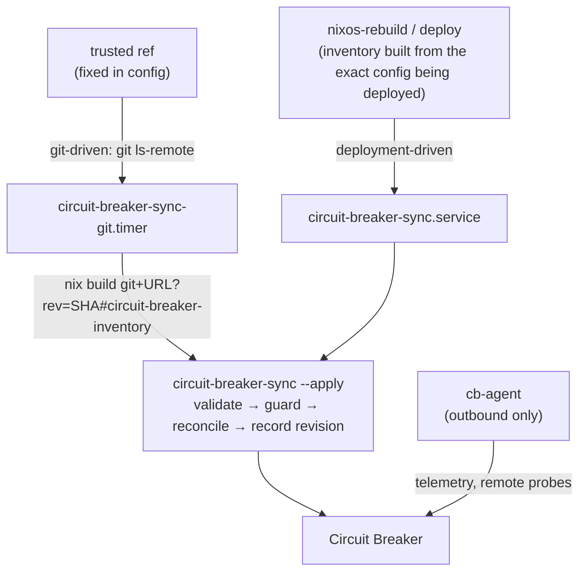

# Circuit Breaker topology from the flake

**Goal:** the flake is the authoritative source for what is *declared*; Circuit Breaker
(CB) provides the interactive map, discovery, live monitoring and *observed* state. There
is no second inventory file to keep in step.

Related: [module reference](../modules/nixos/services/circuit-breaker/README.md),
[runbook](CIRCUIT-BREAKER-RUNBOOK.md),
[troubleshooting](CIRCUIT-BREAKER-TROUBLESHOOTING.md),
[inventory schema](CIRCUIT-BREAKER-INVENTORY.md),
[tests](CIRCUIT-BREAKER-TESTING.md).

## Components

| Piece | Where | Job |
| --- | --- | --- |
| Exporter | `lib/circuit-breaker/` (`lib.fmf.circuitBreaker`) | Pure Nix. Reads *evaluated* `nixosConfigurations` through defensive accessors and emits inventory schema v1. |
| Inventory | JSON, schema v1 | Normalised, deterministic, independent of CB's API, never contains secrets. |
| Reconciler | `packages/circuit-breaker-sync` (`circuit-breaker-sync`, `cb-sync`) | Python, standard library only. Idempotent, narrow `PATCH` updates, ownership-tagged, non-destructive by default. |
| Server package | `packages/circuit-breaker-server` | The upstream server built natively: backend from hash-pinned wheels (`poetry.lock`), web UI from `package-lock.json`. No container image. |
| Module | `modules/nixos/services/circuit-breaker/` | Server as systemd units (PostgreSQL+TimescaleDB, Redis, NATS, migrations, API, workers), sync units, optional agent, hints, assertions. |
| Agent package | `packages/circuit-breaker-agent` | Go `cb-agent` built from the pinned upstream commit, self-update disabled. |

## What is extracted

From each evaluated system (nothing is read from source files):

- **Hosts and VMs** – host name, platform, release, configuration revision, role tags
  (router, hypervisor, kubernetes), primary address and where it came from.
- **MicroVMs** – from `microvm.vms` on the parent host: placement, autostart; from the
  guest: vCPU, memory, TAP interfaces, MACs, virtiofs shares. A removed VM disappears from
  the inventory. A guest no host lists is reported as *unplaced* (info) and not synced.
- **Networks** – declared router zones and hint networks first, then CIDRs derived from
  static interface addresses. Membership is *layer-3 membership only*: a shared subnet is
  never reported as a cable.
- **Interfaces** – systemd-networkd networks and netdevs, `networking.interfaces`,
  bridges, bonds, VLANs, WireGuard (public keys and allowed IPs only), default gateway,
  nameservers.
- **Bridge attachment** – the first-matching networkd `.network` for each TAP, exactly as
  networkd applies it. When several match with different bridges the exporter warns
  (`shadowed_network_match`).
- **Services** – classified through `lib/circuit-breaker/catalog.nix` (reverse proxy,
  database, cache, DNS, auth, secrets, SCM, monitoring, storage, messaging, orchestrator,
  media, remote access) plus any `fmf.services.*` that declares a port. Low-level systemd
  units are deliberately not nodes. Firewall exposure is recorded per port.
- **Containers** – `virtualisation.oci-containers` and NixOS containers declared on a host.
- **Relationships** – `member_of` (network), `attached_to` (TAP → bridge), `proxies_to`
  (Traefik routers → resolved backend service), `uses` (Vault agent clients, DNS
  resolvers), `mounts_from` (NFS and similar), `connects_to` (only from hints).
- **Monitors** – host ICMP, SSH TCP, per-service TCP and HTTPS (published hostnames),
  optional DNS. They describe *what to check*, never a result.
- **Diagnostics** – `unplaced_microvm`, `microvm_without_configuration`,
  `duplicate_microvm_placement`, `shadowed_network_match`, `duplicate_address`,
  `duplicate_id`.

What it refuses to invent: physical device metadata, cabling, rack positions, and any
address it cannot prove. Those come from `hints`.

## Ownership and identity

Identity is the inventory id (for example `vm/vm-vault`, `svc/webb/postgresql`), never an
IP address, so renumbering updates a record instead of duplicating it.

CB has no external-id field, so ownership is recorded in CB itself:

| Entity | Mark |
| --- | --- |
| Networks, hardware, compute units, services | tags `nix:managed`, `nix:id:<id>`, `nix:type:<type>`, `nix:role:*`; `nix:retired` when gone |
| Monitors | name suffix ` [nix:<id>]` |
| Discovery profiles | name prefix `nix: ` |

The reconciler only ever updates or retires entities carrying these marks. Because the
mark lives in CB, losing the reconciler's state file loses history, not ownership.

**Flake-owned fields** (repaired if they drift): hardware `ip_address`, `software_platform`,
`location` (and device role/vendor/model); compute unit kind, OS, address, vCPU, memory and
host; service ports and URL; network CIDR, VLAN, gateway; monitor definition. **Yours** (never
overwritten): names after creation, notes, tags without the `nix:` prefix, icons, canvas
layout, telemetry history.

An unmanaged entity matching by name, address or CIDR is *adopted* (tagged) instead of
duplicated; ambiguous matches are skipped with a warning. CB refuses duplicate IP
addresses, so an address declared twice in the flake is synced without the IP and reported
(`duplicate_address`).

## Three kinds of state

| State | Meaning | Where it shows |
| --- | --- | --- |
| **Committed** | What a Git ref says | The git-driven sync follows it |
| **Evaluated / desired** | What the exporter derives from a specific configuration | The inventory and CB's declared attributes |
| **Deployed / observed** | What machines run and what answers | CB monitors, agent telemetry |

The sync moves *desired* state only. A host appearing in CB means it is declared, not that it
is up: monitors start at `unknown`, and nothing the reconciler writes sets a status of
`running`. If a Git revision is ahead of what is deployed, CB shows the newer plan.

Deployment-driven and git-driven sync can both be enabled; the most recent run wins, and
the module warns. Use deployment-driven alone for "CB matches what I deployed", git-driven
alone for "CB matches `main`".

## Safety rules

- A failed or empty evaluation never changes CB: an inventory without hosts exits 7; one
  that shrank by more than `maxShrinkPercent` exits 7; invalid or secret-looking input exits 2.
- Removal only tags `nix:retired` and pauses the entity's monitors. Hard delete needs
  `policy.retire = "delete"`, `allowDelete = true` and survives `retireGraceDays`.
- Retirement is skipped in a run that had errors.
- API drift: the OpenAPI document is checked before any write (operations and fields the
  adapter uses); a different minor version is refused unless `allowUntestedVersion`.
- Timeouts, bounded retries, backoff. A write whose response was lost is recovered by looking
  the entity up by its ownership mark before retrying.
- The Git source and ref come only from the NixOS configuration; there is no command-line
  override. `flake.lock` is never modified (`--no-update-lock-file`). A revision that fails is
  retried with exponential backoff (5 min doubling to 6 h) and the last good topology stays.

## Verification status

Honest account of what has actually been exercised.

| Area | Evidence |
| --- | --- |
| Exporter | 41 pure-Nix tests (`lib/circuit-breaker/tests.nix`); run on the real Campground (196 resources, 275 relationships, 117 monitors) |
| Reconciler | 118 pytest cases against a fake of CB 0.4.6 built from its real OpenAPI document; mutation spot-checks; run repeatedly against the real server |
| Package | The server derivation imports every pinned Python module (catching missing or unpatched native libraries) and checks the reported version; the web UI builds from its lockfile |
| Module | 68 evaluation-level tests including every invalid option combination, mutation-checked security properties, and a test that every unit renders |
| End to end | NixOS VM test (`checks/circuit-breaker-vm`): the native server (PostgreSQL+TimescaleDB, Redis, NATS, migrations, API, all workers), the real agent on a second VM, hardened sync units, git-driven sync with a real `nix build` |
| Not tested | The server inside a MicroVM (it is tested in a regular NixOS VM); Vault-rendered secrets at runtime (evaluated only); a real Gitea credential flow; `cb restore` of an upstream snapshot; ARP/L2 discovery results; the optional ACME/certbot extra (not part of the package) |

## Known limitations

- CB's `/api/v1` is **not a stable public API** (upstream says so). The adapter is pinned to
  0.4.6 and checks the OpenAPI document; upgrading CB means re-running the tests.
- CB has no endpoint to list hardware connections; the reconciler finds existing ones
  through the topology graph and remembers the ids it created.
- This is a native build of upstream's release, not upstream's tested artifact: upstream's CI
  exercises its image and its `.deb`, not this packaging. The VM test above is what stands in
  for that; re-run it on every upgrade. Differences from upstream's bundle: no nginx (the
  API serves the UI itself; TLS terminates at your proxy or in the API), no pgbouncer, and no
  certbot/ACME (the extra is not in upstream's lockfile). Upstream's agent binary download
  and self-update endpoints have nothing to serve; agents are Nix-managed.
- **Two local patches to upstream** (`packages/circuit-breaker-server/patches/`). In 0.4.6 (and
  upstream `main`) the OIDC id_token is verified without an expected audience; PyJWT rejects every
  token that carries an `aud` claim in that case, so OIDC sign-in (Authentik, Keycloak, ...) fails
  with `InvalidAudienceError` whatever the provider is configured to do. The patch passes the
  configured client ID as the audience (stricter, not looser). The package's install check mints
  HMAC and RSA/JWKS id_tokens and checks that the right audience is accepted and a wrong one is
  rejected. Drop the patch when upstream fixes it; the build fails loudly if the patch no longer
  applies.
- **OIDC sign-in left the browser unable to write** (`oidc-csrf-cookie.patch`). The CSRF middleware
  refuses any write that has a session cookie but no `cb_csrf` cookie and header; only password
  login set that cookie, so a user who signed in through an identity provider could read but every
  change failed with 403 `CSRF token missing` (visible in the journal as "CSRF check failed: missing
  token"; the UI only shows e.g. "Failed to save acknowledgment"). The patch sets the same cookie on
  both OAuth redirects, with the attributes password login uses. The package's install check
  verifies the cookie attributes and that both redirect paths call the helper.
- On first start CB stores `http://<detected-LAN-ip>:8088` as its **App URL**, an address nothing
  serves here. It overrides the forwarded headers and becomes the OIDC `redirect_uri`, so set
  Settings -> Connectivity -> External Access -> App URL to the public `https://` name before
  configuring OIDC.
- Discovery by ARP needs raw-socket access (the discovery worker holds `CAP_NET_RAW`) and a
  segment the server is attached to; use agents on other segments for L2 discovery.
- After first-run setup the effective vault key is the one the wizard generated, kept in
  `<dataDir>/data/.env`; the `CB_VAULT_KEY` you supplied becomes stale (the app logs a warning and
  uses the file). Back up `data/.env` with the database.
- A server on one host cannot sync a flake whose hosts it cannot name: addresses come from
  static configuration or router DHCP reservations; DHCP-only machines without a
  reservation have no address and get no address-based monitors.
