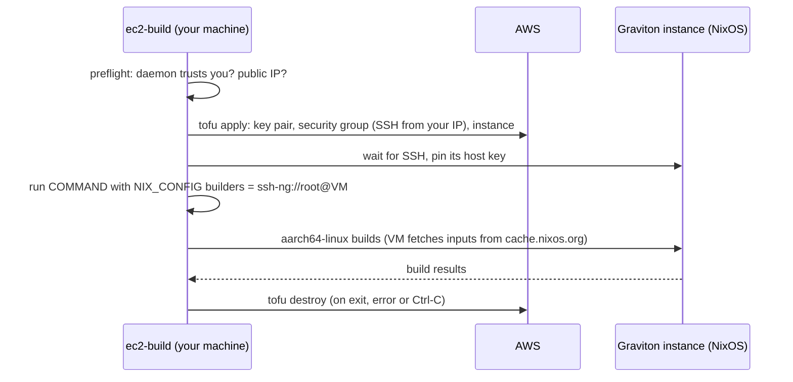

# Building aarch64 on a throwaway EC2 instance

An x86_64 machine cannot build `aarch64-linux` derivations natively. Emulation
(`boot.binfmt.emulatedSystems`) works but is slow. `ec2-build` rents a Graviton machine for the
length of one command instead:

```bash
nix run .#ec2-build -- --env-file ~/.config/ec2-build.env -- \
  nix build .#nixosConfigurations.pikvm.config.system.build.toplevel
```

Everything after `--` is an ordinary command. It runs on your machine; only the `aarch64-linux`
builds go to the instance, and their results are copied back into your store.

> **Status: draft.** The package's pieces were checked without AWS: the terranix output passes
> `tofu validate`, the script passes shellcheck, and the argument parsing, env file, trust check and
> cleanup paths were run against an AWS that refused fake credentials. **A full run against a real
> account has not been done yet.** Treat the first one as the test, and run `ec2-build --list`
> afterwards.

## What happens



1. **Preflight**, before anything is billed: the Nix daemon must trust you (below), and your public
   IPv4 address is looked up (`checkip.amazonaws.com`) so that only it can reach SSH.
2. **Create**: a run directory `~/.local/state/ec2-build/<run-id>/` gets a fresh SSH key, the
   configuration and the OpenTofu state. `tofu apply` creates a key pair, a security group and
   an instance from the newest official NixOS arm64 AMI (owner `427812963091`, `nixos/26.05*`).
   All are tagged `ManagedBy=ec2-build` and `RunId=<run-id>`.
3. **Connect**: the script waits for SSH and pins the host key it first sees (trust on first use).
   The key goes into the builder line, so the daemon checks it too.
4. **Run**: `NIX_CONFIG` gets `builders = ssh-ng://root@<ip> aarch64-linux …` and
   `builders-use-substitutes = true`, then your command runs. Anything that calls `nix` inherits it,
   including `nix run nixpkgs#nixos-generators …`.
5. **Destroy**: on any exit, `tofu destroy`; the run directory is removed only when that succeeds.

## Requirements

**The Nix daemon must trust you.** `builders` is a setting only a trusted user may pass to the
daemon. An untrusted user's setting is dropped with a warning, and the build then fails or runs
locally. `ec2-build` checks `nix store info --json` and stops if you are not trusted. On NixOS:

```nix
nix.settings.trusted-users = ["root" "mcamp"];   # or "@wheel"
```

A trusted user can do anything the daemon can, so this is effectively root. Decide whether you want
that on a given machine. Check with `nix store info --json` (`"trusted":true`).

**AWS credentials** with EC2 rights to describe images, run and terminate instances, and create
and delete key pairs and security groups in the chosen region. A least-privilege policy has not been
worked out yet; a sandbox account with `AmazonEC2FullAccess` works for this.

**A default VPC** in the region, with public IPs on its subnets (new accounts have one). Otherwise
set `EC2_BUILD_VPC_ID` and `EC2_BUILD_SUBNET_ID`.

## The env file

Secrets come from the environment or from a file passed with `--env-file` (or named by
`EC2_BUILD_ENV_FILE`). The file is sourced by the shell, so it is plain `KEY=value` lines. Its
values override the environment. Keep it out of git and readable only by you (`chmod 600`).

```bash
# ~/.config/ec2-build.env
AWS_ACCESS_KEY_ID=AKIA...
AWS_SECRET_ACCESS_KEY=...
# AWS_SESSION_TOKEN=...          # temporary credentials
# AWS_PROFILE=builds             # or a profile from ~/.aws instead of keys
EC2_BUILD_REGION=us-east-1
# EC2_BUILD_INSTANCE_TYPE=c7g.8xlarge
```

| Variable | Default | Meaning |
| --- | --- | --- |
| `EC2_BUILD_REGION` | `$AWS_REGION`, `$AWS_DEFAULT_REGION`, `us-east-1` | Region. |
| `EC2_BUILD_INSTANCE_TYPE` | `c7g.4xlarge` | Any arm64 type (Graviton: `c7g`, `m7g`, `c8g`, …). |
| `EC2_BUILD_VOLUME_GB` | `100` | Root disk (gp3). The store of a big closure needs room. |
| `EC2_BUILD_MAX_MINUTES` | `240` | The instance shuts itself down after this long; see below. |
| `EC2_BUILD_MAX_JOBS` | `4` | Builds sent to the instance at once; each uses all its cores. |
| `EC2_BUILD_AMI` | | An explicit AMI id instead of the lookup. |
| `EC2_BUILD_AMI_NAME` | `nixos/26.05*` | Name pattern for the lookup. |
| `EC2_BUILD_SSH_CIDR` | your public IPv4 `/32` | Who may reach SSH. Set it if you are behind IPv6-only or a proxy. |
| `EC2_BUILD_VPC_ID`, `EC2_BUILD_SUBNET_ID` | default VPC | Set both, or neither. |
| `EC2_BUILD_STATE_DIR` | `~/.local/state/ec2-build` | Run directories. |
| `EC2_BUILD_KEEP` | `0` | `1` is `--keep`. |
| `EC2_BUILD_SKIP_TRUST_CHECK` | `0` | `1` skips the trust preflight. |

## Examples

Build the PiKVM system closure from a downstream flake (Campground), with `ec2-build` taken from fmf:

```bash
nix run 'git+https://gitlab.com/usmcamp0811/dotfiles.git?ref=nixos#ec2-build' -- \
  --env-file ~/.config/ec2-build.env -- \
  nix build .#nixosConfigurations.pikvm.config.system.build.toplevel
```

Build an SD image (the generator itself is x86_64 and runs locally; the image is built on EC2):

```bash
nix run .#ec2-build -- --env-file ~/.config/ec2-build.env -- \
  nix run nixpkgs#nixos-generators -- -f sd-aarch64 --flake .#pikvm --system aarch64-linux -o ./pikvm-sd
```

Keep the instance to look around after a failure, then remove it:

```bash
nix run .#ec2-build -- --keep --env-file ~/.config/ec2-build.env -- nix build …
# prints the ssh command for the instance
nix run .#ec2-build -- --env-file ~/.config/ec2-build.env --cleanup
```

## Safety nets and leftovers

Something you forget about costs money, so there are three layers:

1. **Trap**: the script destroys everything on exit, error, Ctrl-C or `kill`.
2. **Self-destruct**: the instance's user data runs `shutdown -h +EC2_BUILD_MAX_MINUTES`, and the
   instance is created with `instance_initiated_shutdown_behavior = terminate`, so it terminates
   itself even if the script was `kill -9`ed or the laptop went to sleep. This relies on NixOS's
   `amazon-init` running user data that starts with `#!` as a script. Set the limit above your
   longest build. The key pair and security group survive this (they cost nothing).
3. **Cleanup**: every run directory that still exists has resources, or a failed destroy.
   `ec2-build --list` shows them; `ec2-build --cleanup` destroys all of them (it needs the same
   credentials). As a last resort, look in the EC2 console for the tag `ManagedBy=ec2-build`.

## Costs

You pay for the instance while it runs (per second, after the first minute), its disk, and
**data transfer out of AWS**, which includes the build results coming back to you. Check current
prices for your region and instance type. Build inputs are fetched by the instance from
cache.nixos.org (`builders-use-substitutes`), which is inbound and free. Paths only you have, such
as from a private cache it cannot reach, are uploaded from your machine.

## Troubleshooting

| Symptom | Cause |
| --- | --- |
| `the Nix daemon does not trust <you>` | See Requirements. |
| `No valid credential sources found` / `InvalidClientTokenId` | The credentials in the env file or environment are missing or wrong. Nothing was created. |
| `no SSH on <ip> after 5 minutes` | The security group admits `EC2_BUILD_SSH_CIDR`, which is not your real address (VPN, proxy), or the subnet has no internet route. |
| `the instance has no public IP` | The subnet does not auto-assign public IPs. Use a subnet that does. |
| Build says `required system or feature not available` / runs under emulation | The builder was not used: the daemon did not take `builders` (trust), or the derivation needs a feature the line does not offer (`kvm`/`nixos-test`; Graviton instances other than `.metal` have no KVM). |
| `destroy FAILED` | Credentials expired mid-run (session tokens), or a network blip. Run `ec2-build --cleanup` with fresh credentials. |

## Not done

- No spot instances: on-demand only, so a build is never interrupted. Spot would cost less.
- No `kvm`/`nixos-test` feature: NixOS VM tests need a `.metal` instance, and the builder line does
  not advertise those features.
- One instance per run: several commands in a row each pay for their own instance's startup.
- Only `aarch64-linux`. The same approach would work for `x86_64-linux` with another AMI filter.
