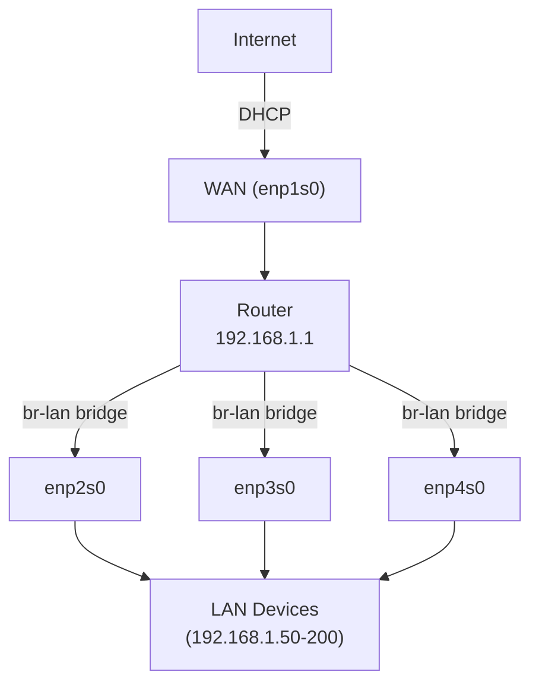
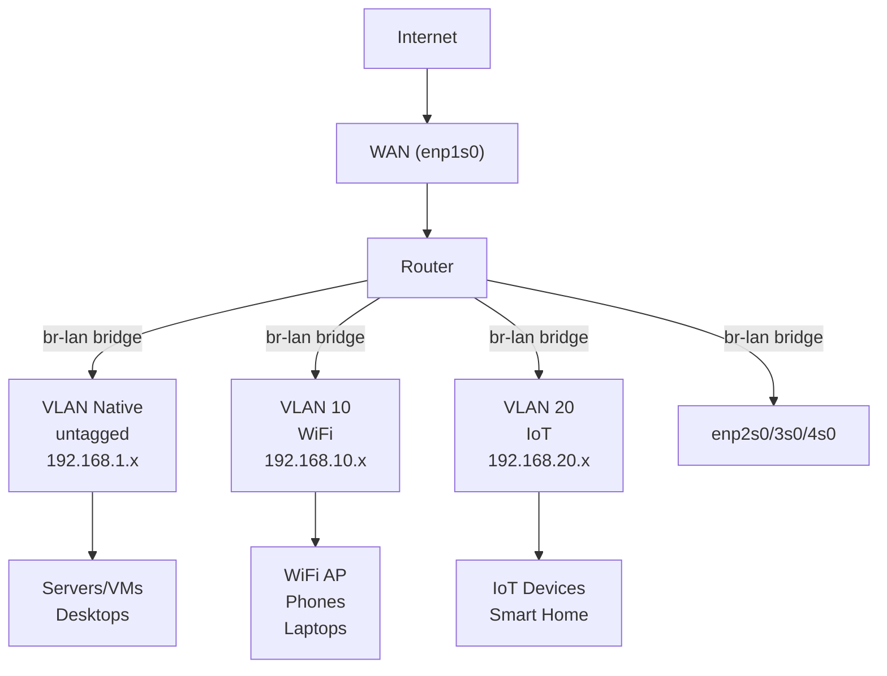
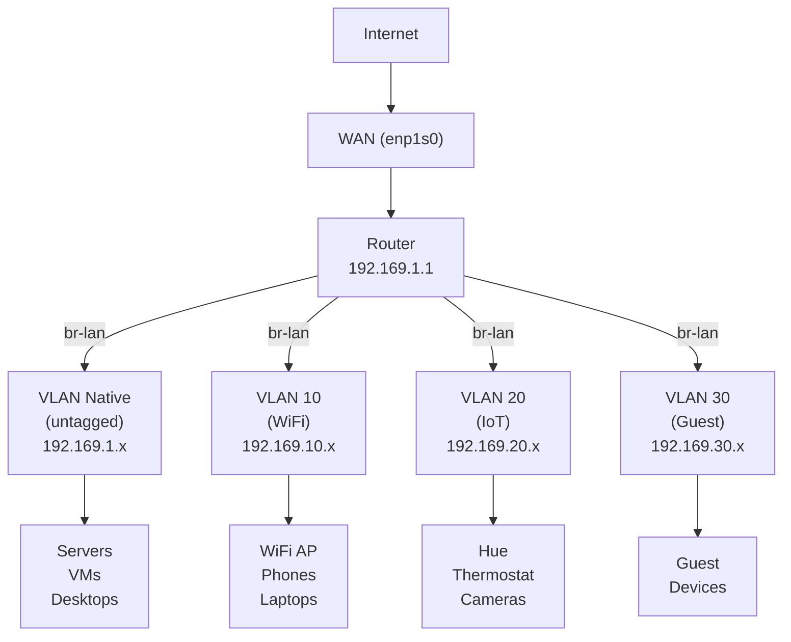
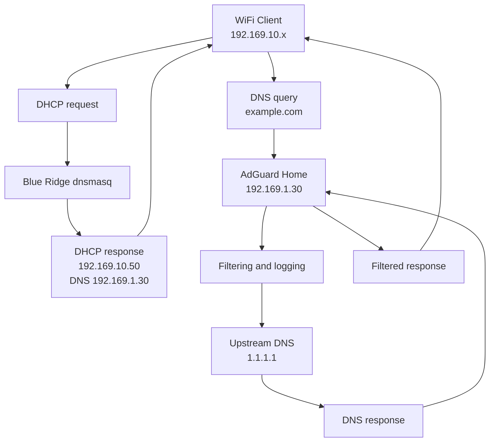

# Router Configuration Examples

Complete real-world configuration examples for the Campground router modules.

## Table of Contents

- [Basic Home Router](#basic-home-router)
- [Home Router with IoT Isolation](#home-router-with-iot-isolation)
- [Advanced Multi-Zone Setup](#advanced-multi-zone-setup)
- [Work-from-Home Setup](#work-from-home-setup)
- [Guest Network Configuration](#guest-network-configuration)
- [Port Forwarding Examples](#port-forwarding-examples)
- [AdGuard Integration](#adguard-integration)
- [Static DHCP Leases](#static-dhcp-leases)
- [VPN Server Setup](#vpn-server-setup)

---

## Basic Home Router

Simple home router with single LAN network, no VLANs.

### Configuration

```nix
# systems/x86_64-linux/router/default.nix
{
  config,
  lib,
  pkgs,
  ...
}: {
  imports = [];

  # Hostname and networking
  networking.hostName = "router";

  # Router configuration
  fmf.router = {
    enable = true;

    # WAN interface (gets IP via DHCP from ISP)
    wan = {
      interface = "enp1s0";
      dhcp = true;
    };

    # LAN configuration
    lan = {
      interfaces = ["enp2s0" "enp3s0" "enp4s0"];
      gateway = "192.168.1.1";
      prefixLength = 24;
    };

    # DHCP server
    dhcp = {
      enable = true;
      rangeStart = "192.168.1.50";
      rangeEnd = "192.168.1.200";
      leaseTime = "12h";
    };

    # DNS configuration
    dns = {
      enable = true;
      forwarders = ["1.1.1.1" "1.0.0.1" "8.8.8.8" "8.8.4.4"];
      enableDNSSEC = true;
    };

    # Firewall
    firewall = {
      allowPing = false;
    };

    # Security hardening
    security = {
      enable = true;
      enableSSH = true;
      fail2ban.enable = true;
    };
  };

  # System configuration
  system.stateVersion = "24.11";
}
```

### Network Topology



---

## Home Router with IoT Isolation

Router with separate WiFi and IoT networks, isolating IoT devices from main LAN.

### Configuration

```nix
# systems/x86_64-linux/router/default.nix
{
  config,
  lib,
  pkgs,
  ...
}: {
  fmf.router = {
    enable = true;

    wan = {
      interface = "enp1s0";
      dhcp = true;
    };

    lan = {
      interfaces = ["enp2s0" "enp3s0" "enp4s0"];
      gateway = "192.168.1.1";
      prefixLength = 24;
    };

    dns = {
      enable = true;
      forwarders = ["1.1.1.1" "1.0.0.1"];
      enableDNSSEC = true;
    };

    security = {
      enable = true;
      enableSSH = true;
      fail2ban.enable = true;
    };

    # Network zones
    zones = {
      enable = true;

      zones = {
        # Main LAN (native/untagged VLAN)
        lan = {
          vlanId = null;
          subnet = "192.168.1.0/24";
          gateway = "192.168.1.1";
          dhcp = {
            enable = true;
            rangeStart = "192.168.1.50";
            rangeEnd = "192.168.1.200";
            leaseTime = "24h";
          };
          allowInternet = true;
          isolation = "none";
          description = "Main LAN for trusted devices";
        };

        # WiFi network (VLAN 10)
        wifi = {
          vlanId = 10;
          subnet = "192.168.10.0/24";
          gateway = "192.168.10.1";
          dhcp = {
            enable = true;
            rangeStart = "192.168.10.50";
            rangeEnd = "192.168.10.200";
            leaseTime = "12h";
          };
          allowInternet = true;
          isolation = "partial";  # Can access LAN
          description = "WiFi network";
        };

        # IoT network (VLAN 20)
        iot = {
          vlanId = 20;
          subnet = "192.168.20.0/24";
          gateway = "192.168.20.1";
          dhcp = {
            enable = true;
            rangeStart = "192.168.20.50";
            rangeEnd = "192.168.20.200";
            leaseTime = "24h";
          };
          allowInternet = true;
          isolation = "full";  # Fully isolated
          description = "IoT devices (smart home)";
        };
      };

      # Allow IoT devices to reach Home Assistant on LAN
      interZoneRoutes = [
        {
          from = "iot";
          to = ["lan"];
          protocol = "tcp";
          ports = [8123];
          destinationIPs = ["192.168.1.100"];
          description = "IoT to Home Assistant";
        }
        {
          from = "iot";
          to = ["lan"];
          protocol = "udp";
          ports = [53 123];  # DNS, NTP
          description = "IoT infrastructure";
        }
        {
          from = "lan";
          to = ["iot" "wifi"];
          description = "LAN admin access";
        }
      ];
    };
  };

  system.stateVersion = "24.11";
}
```

### Network Topology



### Network Access Matrix

| From ↓ / To → | LAN | WiFi | IoT | Internet |
|---------------|-----|------|-----|----------|
| **LAN**       | ✓   | ✓    | ✓   | ✓        |
| **WiFi**      | ✓   | ✓    | ✗   | ✓        |
| **IoT**       | ✗¹  | ✗    | ✗   | ✓        |

¹ Only port 8123 (Home Assistant) and DNS/NTP allowed

---

## Advanced Multi-Zone Setup

Complete home network with LAN, WiFi, IoT, and Guest zones with granular security.

### Configuration

```nix
# systems/x86_64-linux/router/default.nix
{
  config,
  lib,
  pkgs,
  ...
}: {
  fmf.router = {
    enable = true;

    wan = {
      interface = "enp1s0";
      dhcp = true;
    };

    lan = {
      interfaces = ["enp2s0" "enp3s0" "enp4s0"];
      gateway = "192.169.1.1";
      prefixLength = 24;
    };

    dns = {
      enable = true;
      forwarders = ["192.169.1.30"];  # AdGuard Home
      enableDNSSEC = true;
    };

    # Port forwarding
    portForwards = [
      {
        port = 443;
        destination = "192.169.1.100";
        protocol = "tcp";
        description = "HTTPS to web server";
      }
      {
        port = 25565;
        destination = "192.169.1.50";
        protocol = "both";
        description = "Minecraft server";
      }
    ];

    security = {
      enable = true;
      enableSSH = true;
      sshPort = 22;
      fail2ban = {
        enable = true;
        maxRetry = 3;
        banTime = 3600;
      };
    };

    zones = {
      enable = true;

      zones = {
        # LAN - Native VLAN
        lan = {
          vlanId = null;
          subnet = "192.169.1.0/24";
          gateway = "192.169.1.1";
          dhcp = {
            enable = false;  # AdGuard handles DHCP for LAN
          };
          dns = {
            servers = ["192.169.1.30"];  # AdGuard Home
          };
          allowInternet = true;
          isolation = "none";
          description = "Main LAN network for trusted devices and VMs";
        };

        # WiFi - VLAN 10
        wifi = {
          vlanId = 10;
          subnet = "192.169.10.0/24";
          gateway = "192.169.10.1";
          dhcp = {
            enable = true;
            rangeStart = "192.169.10.50";
            rangeEnd = "192.169.10.200";
            leaseTime = "12h";
          };
          dns = {
            servers = ["192.169.1.30"];  # AdGuard Home
          };
          allowInternet = true;
          isolation = "full";
          description = "WiFi network for wireless devices";
        };

        # IoT - VLAN 20
        iot = {
          vlanId = 20;
          subnet = "192.169.20.0/24";
          gateway = "192.169.20.1";
          dhcp = {
            enable = true;
            rangeStart = "192.169.20.50";
            rangeEnd = "192.169.20.200";
            leaseTime = "24h";
            staticLeases = [
              {
                mac = "aa:bb:cc:dd:ee:ff";
                ip = "192.169.20.100";
                hostname = "hue-bridge";
              }
              {
                mac = "11:22:33:44:55:66";
                ip = "192.169.20.101";
                hostname = "thermostat";
              }
            ];
          };
          dns = {
            servers = ["192.169.1.30"];
          };
          allowInternet = true;
          isolation = "full";
          description = "IoT network for smart home devices";
        };

        # Guest - VLAN 30
        guest = {
          vlanId = 30;
          subnet = "192.169.30.0/24";
          gateway = "192.169.30.1";
          dhcp = {
            enable = true;
            rangeStart = "192.169.30.50";
            rangeEnd = "192.169.30.200";
            leaseTime = "2h";
          };
          dns = {
            servers = ["1.1.1.3" "1.0.0.3"];  # Cloudflare malware blocking
          };
          allowInternet = true;
          isolation = "full";
          description = "Guest network for visitors";
        };
      };

      # Granular inter-zone routing
      interZoneRoutes = [
        # IoT can reach Home Assistant only
        {
          from = "iot";
          to = ["lan"];
          protocol = "tcp";
          ports = [8123];
          destinationIPs = ["192.169.1.100"];
          description = "IoT to Home Assistant";
        }

        # IoT can reach DNS/NTP
        {
          from = "iot";
          to = ["lan"];
          protocol = "udp";
          ports = [53 123];
          description = "IoT to DNS/NTP";
        }

        # WiFi can access file shares and SSH
        {
          from = "wifi";
          to = ["lan"];
          protocol = "tcp";
          ports = [22 139 445 3389];  # SSH, SMB, RDP
          description = "WiFi to LAN services";
        }

        # WiFi can ping LAN
        {
          from = "wifi";
          to = ["lan"];
          protocol = "icmp";
          description = "WiFi ping LAN";
        }

        # Guest can print only
        {
          from = "guest";
          to = ["lan"];
          protocol = "tcp";
          ports = [631 9100];  # IPP, HP JetDirect
          destinationIPs = ["192.169.1.50"];
          description = "Guest printing";
        }

        # LAN has full admin access
        {
          from = "lan";
          to = ["iot" "wifi" "guest"];
          description = "LAN admin access";
        }
      ];
    };
  };

  system.stateVersion = "24.11";
}
```

### Network Topology



### Security Matrix

| Zone  | Internet | LAN Access | IoT Access | WiFi Access | Guest Access |
|-------|----------|------------|------------|-------------|--------------|
| LAN   | ✓        | Full       | Full       | Full        | Full         |
| WiFi  | ✓        | SSH, SMB, RDP, ICMP | ✗ | Full | ✗           |
| IoT   | ✓        | HA (8123), DNS, NTP | ✗ | ✗ | ✗              |
| Guest | ✓        | Printer only | ✗       | ✗           | ✗            |

---

## Work-from-Home Setup

Separate work and personal networks with additional security.

### Configuration

```nix
{
  fmf.router = {
    enable = true;

    wan = {
      interface = "enp1s0";
      dhcp = true;
    };

    lan = {
      interfaces = ["enp2s0" "enp3s0" "enp4s0"];
      gateway = "10.0.1.1";
      prefixLength = 24;
    };

    dns = {
      enable = true;
      forwarders = ["1.1.1.1" "1.0.0.1"];
      enableDNSSEC = true;
    };

    # VPN for remote access to work network
    portForwards = [
      {
        port = 51820;
        destination = "10.0.50.1";
        protocol = "udp";
        description = "WireGuard VPN";
      }
    ];

    security = {
      enable = true;
      enableSSH = true;
      fail2ban = {
        enable = true;
        maxRetry = 3;
        banTime = 7200;  # 2 hours
      };
    };

    zones = {
      enable = true;

      zones = {
        # Personal LAN
        lan = {
          vlanId = null;
          subnet = "10.0.1.0/24";
          gateway = "10.0.1.1";
          dhcp = {
            enable = true;
            rangeStart = "10.0.1.50";
            rangeEnd = "10.0.1.200";
          };
          allowInternet = true;
          isolation = "none";
          description = "Personal network";
        };

        # Work network (VLAN 50)
        work = {
          vlanId = 50;
          subnet = "10.0.50.0/24";
          gateway = "10.0.50.1";
          dhcp = {
            enable = true;
            rangeStart = "10.0.50.50";
            rangeEnd = "10.0.50.100";
            staticLeases = [
              {
                mac = "aa:bb:cc:dd:ee:ff";
                ip = "10.0.50.10";
                hostname = "work-laptop";
              }
            ];
          };
          allowInternet = true;
          isolation = "full";
          description = "Work network (isolated)";
        };

        # Personal WiFi (VLAN 10)
        wifi = {
          vlanId = 10;
          subnet = "10.0.10.0/24";
          gateway = "10.0.10.1";
          dhcp = {
            enable = true;
            rangeStart = "10.0.10.50";
            rangeEnd = "10.0.10.200";
          };
          allowInternet = true;
          isolation = "partial";
          description = "Personal WiFi";
        };

        # Guest (VLAN 30)
        guest = {
          vlanId = 30;
          subnet = "10.0.30.0/24";
          gateway = "10.0.30.1";
          dhcp = {
            enable = true;
            rangeStart = "10.0.30.50";
            rangeEnd = "10.0.30.200";
          };
          allowInternet = true;
          isolation = "full";
          description = "Guest network";
        };
      };

      # Work network can access LAN printer only
      interZoneRoutes = [
        {
          from = "work";
          to = ["lan"];
          protocol = "tcp";
          ports = [631 9100];
          destinationIPs = ["10.0.1.50"];
          description = "Work to printer";
        }
        {
          from = "lan";
          to = ["work" "wifi"];
          description = "Personal LAN admin access";
        }
      ];
    };
  };
}
```

### Use Cases

- **Work devices** (VLAN 50): Fully isolated, can only print to personal LAN printer
- **Personal devices** (LAN): Full access to all networks
- **Personal WiFi** (VLAN 10): Can access personal LAN
- **Guests** (VLAN 30): Internet-only, no local access

---

## Guest Network Configuration

Minimal guest network with internet-only access.

### Configuration

```nix
{
  fmf.router.zones = {
    enable = true;

    zones = {
      lan = {
        vlanId = null;
        subnet = "192.168.1.0/24";
        gateway = "192.168.1.1";
        dhcp = {
          enable = true;
          rangeStart = "192.168.1.50";
          rangeEnd = "192.168.1.200";
        };
        allowInternet = true;
        isolation = "none";
      };

      # Guest network - Internet only
      guest = {
        vlanId = 99;
        subnet = "192.168.99.0/24";
        gateway = "192.168.99.1";
        dhcp = {
          enable = true;
          rangeStart = "192.168.99.50";
          rangeEnd = "192.168.99.200";
          leaseTime = "1h";  # Short lease time
        };
        dns = {
          servers = ["1.1.1.3" "1.0.0.3"];  # Cloudflare malware blocking
        };
        allowInternet = true;
        isolation = "full";  # No LAN access
        description = "Guest WiFi - Internet only";
      };
    };

    # No inter-zone routes (guests can't access anything local)
    interZoneRoutes = [];
  };
}
```

---

## Port Forwarding Examples

### Web Server and Minecraft

```nix
{
  fmf.router.portForwards = [
    # HTTP (redirect to HTTPS)
    {
      port = 80;
      destination = "192.168.1.100";
      protocol = "tcp";
      description = "HTTP to web server";
    }

    # HTTPS
    {
      port = 443;
      destination = "192.168.1.100";
      protocol = "tcp";
      description = "HTTPS to web server";
    }

    # Minecraft server
    {
      port = 25565;
      destination = "192.168.1.50";
      protocol = "both";  # TCP and UDP
      description = "Minecraft server";
    }

    # SSH to specific server (non-standard port)
    {
      port = 2222;
      destination = "192.168.1.10";
      destinationPort = 22;  # Forward to port 22 internally
      protocol = "tcp";
      description = "SSH to dev server";
    }
  ];
}
```

### Home Automation Services

```nix
{
  fmf.router.portForwards = [
    # Home Assistant
    {
      port = 8123;
      destination = "192.168.1.100";
      protocol = "tcp";
      description = "Home Assistant";
    }

    # Plex Media Server
    {
      port = 32400;
      destination = "192.168.1.101";
      protocol = "tcp";
      description = "Plex Media Server";
    }

    # UniFi Controller
    {
      port = 8443;
      destination = "192.168.1.102";
      protocol = "tcp";
      description = "UniFi Controller";
    }
  ];
}
```

---

## AdGuard Integration

Router with AdGuard Home for DNS filtering across all zones.

### Router Configuration

```nix
{
  fmf.router = {
    enable = true;

    wan = {
      interface = "enp1s0";
      dhcp = true;
    };

    lan = {
      interfaces = ["enp2s0" "enp3s0" "enp4s0"];
      gateway = "192.169.1.1";
      prefixLength = 24;
    };

    # Router DNS forwards to AdGuard
    dns = {
      enable = true;
      forwarders = ["192.169.1.30"];  # AdGuard Home IP
      enableDNSSEC = false;  # AdGuard handles DNSSEC
    };

    zones = {
      enable = true;

      zones = {
        lan = {
          vlanId = null;
          subnet = "192.169.1.0/24";
          gateway = "192.169.1.1";
          dhcp = {
            enable = false;  # AdGuard handles DHCP for LAN
          };
          dns = {
            servers = ["192.169.1.30"];  # AdGuard
          };
          allowInternet = true;
          isolation = "none";
        };

        wifi = {
          vlanId = 10;
          subnet = "192.169.10.0/24";
          gateway = "192.169.10.1";
          dhcp = {
            enable = true;  # dnsmasq handles DHCP
            rangeStart = "192.169.10.50";
            rangeEnd = "192.169.10.200";
          };
          dns = {
            servers = ["192.169.1.30"];  # AdGuard for filtering
          };
          allowInternet = true;
          isolation = "partial";
        };

        iot = {
          vlanId = 20;
          subnet = "192.169.20.0/24";
          gateway = "192.169.20.1";
          dhcp = {
            enable = true;
            rangeStart = "192.169.20.50";
            rangeEnd = "192.169.20.200";
          };
          dns = {
            servers = ["192.169.1.30"];  # AdGuard for filtering
          };
          allowInternet = true;
          isolation = "full";
        };
      };

      interZoneRoutes = [
        {
          from = "iot";
          to = ["lan"];
          protocol = "tcp";
          ports = [8123];
          destinationIPs = ["192.169.1.100"];
          description = "IoT to Home Assistant";
        }
      ];
    };
  };
}
```

### AdGuard VM Configuration

```nix
# systems/x86_64-linux/adguard/default.nix
{
  config,
  lib,
  pkgs,
  ...
}: {
  networking = {
    hostName = "adguard";
    interfaces.lan0.ipv4.addresses = [
      {
        address = "192.169.1.30";
        prefixLength = 24;
      }
    ];
    defaultGateway = "192.169.1.1";
    nameservers = ["1.1.1.1" "1.0.0.1"];
  };

  services.adguardhome = {
    enable = true;
    mutableSettings = false;
    settings = {
      bind_host = "0.0.0.0";
      bind_port = 3000;

      # DHCP for LAN only
      dhcp = {
        enabled = true;
        interface_name = "lan0";
        dhcpv4 = {
          gateway_ip = "192.169.1.1";
          subnet_mask = "255.255.255.0";
          range_start = "192.169.1.50";
          range_end = "192.169.1.200";
          lease_duration = 86400;  # 24 hours
        };
      };

      # DNS configuration
      dns = {
        bind_hosts = ["0.0.0.0"];
        port = 53;
        upstream_dns = [
          "1.1.1.1"
          "1.0.0.1"
          "8.8.8.8"
          "8.8.4.4"
        ];
        bootstrap_dns = [
          "1.1.1.1"
          "1.0.0.1"
        ];
        enable_dnssec = true;
      };

      # Filtering
      filtering = {
        enabled = true;
        update_interval = 24;
      };

      filters = [
        {
          enabled = true;
          url = "https://adguardteam.github.io/AdGuardSDNSFilter/Filters/filter.txt";
          name = "AdGuard DNS filter";
        }
        {
          enabled = true;
          url = "https://raw.githubusercontent.com/StevenBlack/hosts/master/hosts";
          name = "Steven Black's List";
        }
      ];
    };
  };

  networking.firewall.allowedTCPPorts = [53 3000];
  networking.firewall.allowedUDPPorts = [53 67];

  system.stateVersion = "24.11";
}
```

### Traffic Flow



---

## Static DHCP Leases

### Home Network with Static IPs

```nix
{
  fmf.router.zones = {
    zones = {
      lan = {
        dhcp = {
          staticLeases = [
            {
              mac = "00:11:22:33:44:55";
              ip = "192.168.1.10";
              hostname = "desktop";
            }
            {
              mac = "aa:bb:cc:dd:ee:ff";
              ip = "192.168.1.20";
              hostname = "nas";
            }
            {
              mac = "11:22:33:44:55:66";
              ip = "192.168.1.30";
              hostname = "printer";
            }
          ];
        };
      };

      iot = {
        dhcp = {
          staticLeases = [
            {
              mac = "aa:bb:cc:dd:ee:01";
              ip = "192.168.20.100";
              hostname = "hue-bridge";
            }
            {
              mac = "aa:bb:cc:dd:ee:02";
              ip = "192.168.20.101";
              hostname = "thermostat";
            }
            {
              mac = "aa:bb:cc:dd:ee:03";
              ip = "192.168.20.102";
              hostname = "security-camera";
            }
            {
              mac = "aa:bb:cc:dd:ee:04";
              ip = "192.168.20.103";
              hostname = "smart-switch";
            }
          ];
        };
      };
    };
  };
}
```

---

## VPN Server Setup

Router with WireGuard VPN for remote access.

### Configuration

```nix
{
  fmf.router = {
    enable = true;

    wan = {
      interface = "enp1s0";
      dhcp = true;
    };

    lan = {
      interfaces = ["enp2s0" "enp3s0" "enp4s0"];
      gateway = "192.168.1.1";
    };

    # Port forward for WireGuard
    portForwards = [
      {
        port = 51820;
        destination = "192.168.1.1";  # Router itself
        protocol = "udp";
        description = "WireGuard VPN";
      }
    ];

    # Allow WireGuard through firewall
    firewall.extraRules = ''
      table inet filter {
        chain input {
          udp dport 51820 accept
        }
      }
    '';
  };

  # WireGuard VPN server
  networking.wireguard.interfaces.wg0 = {
    ips = ["10.100.0.1/24"];
    listenPort = 51820;
    privateKeyFile = "/etc/wireguard/private.key";

    peers = [
      # Phone
      {
        publicKey = "PHONE_PUBLIC_KEY";
        allowedIPs = ["10.100.0.2/32"];
      }
      # Laptop
      {
        publicKey = "LAPTOP_PUBLIC_KEY";
        allowedIPs = ["10.100.0.3/32"];
      }
    ];

    postSetup = ''
      ${pkgs.iptables}/bin/iptables -A FORWARD -i wg0 -j ACCEPT
      ${pkgs.iptables}/bin/iptables -A FORWARD -o wg0 -j ACCEPT
    '';
  };

  # Allow VPN clients to access LAN
  networking.nftables.ruleset = lib.mkAfter ''
    table inet filter {
      chain forward {
        iifname "wg0" accept
        oifname "wg0" accept
      }
    }
  '';
}
```

### Client Configuration

Save this as `wg0.conf` on your phone/laptop:

```ini
[Interface]
PrivateKey = CLIENT_PRIVATE_KEY
Address = 10.100.0.2/24
DNS = 192.168.1.1

[Peer]
PublicKey = ROUTER_PUBLIC_KEY
Endpoint = YOUR_PUBLIC_IP:51820
AllowedIPs = 192.168.1.0/24, 10.100.0.0/24
PersistentKeepalive = 25
```

---

## Additional Examples

### Multiple Static WAN IPs

```nix
{
  fmf.router.wan = {
    interface = "enp1s0";
    dhcp = false;
    staticIPv4 = "203.0.113.10/29";  # /29 gives 6 usable IPs
  };

  # Additional static IPs
  systemd.network.networks."20-wan".address = [
    "203.0.113.10/29"  # Primary
    "203.0.113.11/32"  # Secondary
    "203.0.113.12/32"  # Tertiary
  ];
}
```

### Custom DNS for Specific Zone

```nix
{
  fmf.router.zones.zones.guest = {
    vlanId = 30;
    subnet = "192.168.99.0/24";
    gateway = "192.168.99.1";
    dhcp.enable = true;
    dns = {
      # Use Cloudflare Family DNS (blocks adult content)
      customForwarders = ["1.1.1.3" "1.0.0.3"];
    };
    allowInternet = true;
    isolation = "full";
  };
}
```

### Logging All Dropped Packets

```nix
{
  fmf.router.firewall.extraRules = ''
    table inet filter {
      chain input {
        log prefix "INPUT DROP: " level info
      }
      chain forward {
        log prefix "FORWARD DROP: " level info
      }
    }
  '';
}
```

Then view logs with: `journalctl -k | grep DROP`
