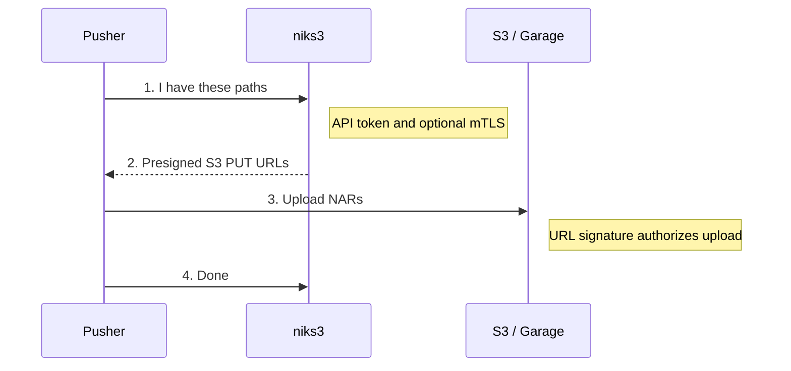

# niks3 (Nix binary cache) — server, uploader, and access model

Modules involved:

| Module | Purpose |
|---|---|
| `fmf.services.niks3` (this dir) | niks3 server: S3-backed cache, GC, landing page, read proxy |
| `fmf.services.niks3-auto-upload` | post-build-hook uploader (push every locally built path) |
| `fmf.cache.niks3` | adds the cache as a substituter on clients (URL + public signing key) |
| `fmf.services.garage` | the S3 backend (`backend = "garage"`, the default) |

niks3 is Mic92/niks3. This module is a thin, Vault-fed wrapper around the
upstream NixOS module (`inputs.niks3.nixosModules.niks3`).

## How data moves

niks3 has **no upload proxy**. A push is two conversations:



A pull is only talking to niks3. With `settings.readProxy.enable = true` niks3
fetches objects from S3 itself and serves them, so the bucket can stay private
and clients only need niks3's URL.

Consequences worth knowing:

- `s3.publicUrl` is baked into the presigned URLs. It must be a name **pushers
  can reach**. If remote machines push, that is a public S3 hostname, not
  `127.0.0.1:3900`.
- Pushers never need the S3 credentials. Only the niks3 server holds them
  (rendered from Vault by vault-agent). Don't hand them out; they grant the whole
  bucket.

## Who needs which credential

| Action | Credential |
|---|---|
| Push (public endpoint) | a **client certificate + key** (mTLS). That is the *only* credential: no API token |
| Push (trusted LAN endpoint) | niks3 **API token** (bearer) |
| Pull (public endpoint) | a **client certificate**, read-only (`CN=niks3-pull-*`) or a push cert; Nix >= 2.34 passes it via the substituter URL |
| Pull (trusted LAN) | nothing, via a restricted read-only listener |
| Upload NAR bytes to S3 | the presigned URL niks3 returned (nothing to configure) |
| Garage bucket key | niks3 server only |

Nix can present a TLS client certificate to a substituter from 2.34 on (per-store
`tls-certificate` / `tls-private-key`, set as URL query parameters), so pulls can
use mTLS too. Older Nix cannot; use basic auth via `netrc-file` for those, or
keep them on a trusted network.

niks3 itself accepts *either* an API token *or* a verified client certificate,
and it cannot be told to refuse the token. A pusher that only holds a
certificate never needs the token, but the token keeps working for anyone who
has it, on any endpoint that reaches niks3's plain-HTTP port. That is why the
public push endpoint exposes only an mTLS-gated route and the token stays on the
trusted LAN.

## Server configuration

```nix
fmf.services.niks3 = {
  enable = true;
  # backend = "garage" (default): uses the co-located fmf.services.garage and
  # its "niks3" bucket/key, from Vault.
  httpAddr = "0.0.0.0:5751";               # reachable by the reverse proxy
  cacheUrl = "https://niks3.example.com";
  s3.publicUrl = "https://s3.example.com"; # what pushers will PUT to
  settings.readProxy.enable = true;        # serve reads through niks3
};
```

Vault secrets (KV, default `secret/campground/...`):

- `secret/campground/niks3` — `api_token` (≥ 36 chars), `sign_key`
  (`name:base64`, from `nix key generate-secret`)
- `secret/campground/garage` — Garage RPC secret / admin token
- `secret/campground/garage/buckets/niks3` — `access_key_id`, `secret_access_key`

## Watchdogs and automatic recovery

Recovery is part of **this niks3 NixOS module**, not a VM/host-specific module.
It is enabled by default when `fmf.services.niks3.enable = true` and requires no
new secrets. nginx monitoring is only installed when niks3's nginx frontend is
enabled (through `nginx.enable` or `settings.nginx.enable`).

```nix
fmf.services.niks3 = {
  enable = true;
  watchdog = {
    enable = true;
    timeout = "30s";
    checkInterval = "30s";
    startupDelay = "2min";
    nginx = {
      enable = true;
      healthPort = 8082;
    };
  };
};
```

| Option (`watchdog.*`) | Default | Purpose |
|---|---|---|
| `enable` | `true` | Enable native niks3 watchdog and periodic recovery checks |
| `timeout` | `"30s"` | Native systemd WATCHDOG heartbeat deadline |
| `checkInterval` | `"30s"` | Time after a check finishes before the next check |
| `startupDelay` | `"2min"` | Initial timer delay after boot |
| `healthUrl` | direct `httpAddr` + `/health`, wildcard addresses mapped to loopback | niks3 liveness probe |
| `nginx.enable` | `true` | Check nginx if niks3's nginx frontend is enabled |
| `nginx.healthPort` | `8082` | Unused loopback-only nginx health port |

### What is checked

- **Native niks3 watchdog:** the upstream server already sends systemd
  `WATCHDOG=1` heartbeats; its heartbeat loop is gated on a PostgreSQL ping.
  The deadline is exposed through `watchdog.timeout`. Both services retain their
  upstream `Restart=always`/10-second behavior, and startup-rate limiting is
  disabled for monitored services so repeated failures do not strand them.
- **`niks3-watchdog.timer`:** checks that `niks3.service` is active and its
  direct, unauthenticated `/health` endpoint returns HTTP **200**. This handler
  is liveness-only and does not query PostgreSQL or S3. Do not replace it with
  `/readyz` or a URL through nginx: those test different failure domains.
- **`niks3-nginx-watchdog.timer`:** requires active nginx and HTTP **204** from
  `http://127.0.0.1:<healthPort>/healthz`, served directly by a loopback-only nginx
  virtual host. It does not require Vault credentials or mTLS and opens no
  firewall port.

Three failed probes, five seconds apart, trigger a service restart followed by
up to six recovery probes. Checks do not overlap. Startup, shutdown and reload
operations are left alone; nginx's check also avoids interrupting a niks3
lifecycle transition. Before restarting niks3, its systemd `Requires`/`BindsTo`
dependencies (e.g. sockets, local PostgreSQL, Vault Agent) must be active. Missing
dependencies fail/log the check instead of being repeatedly restarted.

This does not mean database outages can never restart niks3: the **native**
heartbeat watchdog is database-gated. The HTTP timer deliberately uses
liveness, not readiness, to avoid adding another database-driven restart loop.
Restarting niks3 may restart services marked `PartOf=niks3.service`, including
nginx/certificate setup in Campground's configuration. Active uploads or downloads
can be interrupted. Watchdogs do not restart PostgreSQL or Garage themselves.

If `httpAddr` binds a specific interface, the default probe uses that address.
For an unusual listener, override `watchdog.healthUrl` with a directly reachable
local `/health` URL. Choose a different unused `nginx.healthPort` if 8082 is taken.
`watchdog.enable = false` disables both timers and the native heartbeat deadline;
ordinary crash restart behavior remains. `watchdog.nginx.enable = false` disables
only nginx monitoring without altering the niks3 watchdog.

### Status, failure reporting and maintenance

```bash
systemctl list-timers niks3-watchdog.timer niks3-nginx-watchdog.timer --no-pager
sudo journalctl -u niks3-watchdog.service -u niks3-nginx-watchdog.service \
  -u niks3.service -u nginx.service -n 100 --no-pager
```

Successful oneshot checks normally return to `inactive (dead)`. Failed restarts,
timeouts, unavailable dependencies and unsuccessful recovery are visible in the
unit result and journal. These checks **do not send email/chat notifications**;
use your monitoring system for alerts and end-to-end cache/TLS/DNS checks.

The timers deliberately restart a manually stopped service. Before maintenance,
stop the applicable timers and in-flight checks first:

```bash
sudo systemctl stop niks3-watchdog.timer niks3-nginx-watchdog.timer
sudo systemctl stop niks3-watchdog.service niks3-nginx-watchdog.service
sudo systemctl stop niks3.service nginx.service
```

When maintenance is complete:

```bash
sudo systemctl start niks3.service nginx.service
sudo systemctl start niks3-watchdog.timer niks3-nginx-watchdog.timer
```

Omit nginx units when the frontend is disabled. Because niks3 is socket-activated,
stopping just the service is not complete isolation: client traffic can activate
it again. Stop its socket units too if your maintenance requires that isolation.
Only test deliberate crashes/stops on a disposable instance or during a scheduled
outage; do not interrupt an active cache build or upload.

## Exposing it publicly with mTLS-only pushers

Verifying a certificate at a reverse proxy is *not* the same as niks3 trusting
it: niks3 only honours a verified identity if it is told to
(`--mtls-proxy-header` / `--mtls-proxy-socket`), and it only trusts that header
on a **private unix socket** (it strips it on the network port). Upstream wires
this through its nginx integration (`nginx.mtls`), exposed here via `settings`:

```nix
fmf.services.niks3 = {
  nginx = { enable = true; domain = "niks3.example.com"; };
  settings.nginx = {
    enableACME = false; forceSSL = false;   # cert comes from elsewhere (below)
    mtls = {
      enable = true;
      require = true;                       # ssl_verify_client on
      clientCAFile = "/path/to/client-ca.pem";
      boundSubjects = ["CN=niks3-push-*"];      # may write (and read)
      boundSubjectsRead = ["CN=niks3-pull-*"];  # read-only; also gates reads for everyone else
    };
  };
};
```

nginx runs on the niks3 host and listens on 443. A cert whose subject doesn't
match `boundSubjects` (e.g. a build-farm cert from the same CA) passes nginx but
gets 401 from niks3. Don't instead have an external proxy (Traefik on another
host) assert the "verified" header over the network: niks3 would then trust that
header on its normal port, so anything that can reach the port could forge admin
access.

Because the proxy must see the client's certificate, the public front door
(Traefik) **passes TLS through** for the push hostname instead of terminating it.
Consequences: the server certificate for that name is not a Let's Encrypt cert
at Traefik (it is issued to nginx, e.g. from Vault PKI, so pushers must trust
that CA), and Traefik HTTP middlewares such as its fail2ban plugin cannot apply
(rate limiting moves to nginx, keyed on the client cert subject, since Traefik
hides the source IP).

Hostnames (Traefik applies TLS policy per SNI name, not per path):

| Hostname | Routes | Auth |
|---|---|---|
| `niks3.<domain>` (and an alias `push.niks3.<domain>`) | TLS passthrough to nginx; reads **and** pushes, `/metrics` and health endpoints return 404 | client cert (mTLS) for everything |
| `s3.<domain>` | Garage S3 API | presigned-URL signatures |

Because reads are gated, a cert subject decides what a client may do:

- `boundSubjects` (e.g. `CN=niks3-push-*`): may push (and read).
- `boundSubjectsRead` (e.g. `CN=niks3-pull-*`): read-only. Nobody without a
  matching cert can list or fetch anything, so the cache contents are not
  discoverable.

Nix (>= 2.34) can present a client certificate for reads via per-store settings
`tls-certificate` / `tls-private-key`, passed as query parameters on the
substituter URL (they do not show up in `nix config show`; see
`man nix3-help-stores`). The niks3 CLI itself only has `push`, `gc` and `pins`;
there is no CLI pull command, Nix does the reading.

**Gating reads is global to niks3**, not per listener: once `boundSubjectsRead`
is set, the plain port (:5751) also rejects anonymous reads. To keep a trusted
LAN reading anonymously, run a second nginx listener that only the LAN reverse
proxy may reach, serves only the cache paths, and asserts a *read-only* subject
over the unix socket (see `systems/x86_64-linux/vm-niks3` in Campground). It
can never push because the asserted subject only matches `boundSubjectsRead`.
Pushing from the LAN with the API token still uses :5751 directly.

`s3` exposes Garage's S3 API only (never its admin API) and the bucket stays
private, so authorization is purely the SigV4 signature on each URL.

Practical notes:

- Put the push and S3 hostnames on **DNS-only** (not Cloudflare-proxied). The
  proxy would terminate TLS, so origin mTLS can't work, and large NAR uploads hit
  proxy body limits.
- LAN clients should resolve the public names internally (split DNS) rather than
  hairpinning through the WAN.
- Reference implementation: `systems/x86_64-linux/vm-niks3` and
  `campground.suites.public-hosting` in the Campground repo.

### Vault PKI roles this needs (create by hand)

Server cert for nginx (rendered by vault-agent) and long-lived pusher certs, on
the same CA as the build farm (`grpc-farm-pki`), with **separate roles** so a
pusher can never obtain a server-flagged cert:

```bash
vault write grpc-farm-pki/roles/niks3-push-server \
  allowed_domains="niks3.example.com,push.niks3.example.com" allow_bare_domains=true \
  allow_subdomains=false server_flag=true client_flag=false \
  key_type=ec key_bits=256 ttl=720h max_ttl=2160h

vault write grpc-farm-pki/roles/niks3-push-client \
  allowed_domains="niks3-push-*" allow_glob_domains=true allow_bare_domains=true \
  allow_subdomains=false server_flag=false client_flag=true \
  key_type=ec key_bits=256 ttl=4320h max_ttl=8760h

vault write grpc-farm-pki/roles/niks3-pull-client \
  allowed_domains="niks3-pull-*" allow_glob_domains=true allow_bare_domains=true \
  allow_subdomains=false server_flag=false client_flag=true \
  key_type=ec key_bits=256 ttl=4320h max_ttl=8760h
```

The niks3 host's AppRole needs `update` on `grpc-farm-pki/issue/niks3-push-server`
and `read` on `grpc-farm-pki/cert/ca`. nginx trusts *every* cert on that CA, so
`boundSubjects` is what actually limits who may write; a long-lived client role
is only as safe as who may call `issue/niks3-push-client`. A dedicated PKI mount
keeps farm certs and push certs fully separate if that matters to you.

## Vault: getting credentials for a pusher

Run these yourself with your own Vault token. The pusher gets a certificate and
key, **not** the niks3 API token and **not** any Garage key (Garage upload
authorization is the presigned URLs niks3 hands back):

```bash
umask 077
vault write -format=json grpc-farm-pki/issue/niks3-push-client \
  common_name=niks3-push-<name> ttl=4320h > /tmp/niks3-cert.json
jq -r .data.certificate /tmp/niks3-cert.json > client.crt
jq -r .data.private_key /tmp/niks3-cert.json > client.key
jq -r .data.issuing_ca  /tmp/niks3-cert.json > ca.crt   # to verify the server
shred -u /tmp/niks3-cert.json
chmod 600 client.key
```

Because the server certificate comes from the farm CA, pushers must trust it.
**Pass a bundle, not `ca.crt` alone:** the niks3 client uses a single CA setting
for every request, including the presigned uploads to the public S3 host
(`s3.<domain>`, a normal public certificate). With only the farm CA those uploads
fail with `x509: certificate signed by unknown authority`. So `--ca-cert` (and
e.g. Crystal Forge's "custom server CA" field) needs the farm CA **plus** the
public roots:

```bash
cat ca.crt /etc/ssl/certs/ca-certificates.crt > ca-bundle.pem
```

(A way to avoid this entirely would be a publicly trusted cert for the push
hostname on nginx, e.g. ACME DNS-01; not done here.)

### One-shot onboarding script

`niks3-onboard` (package `packages/scripts/niks3-onboard`; `nix run
.#niks3-onboard -- <name>`) does all of the above and writes a ready-to-use
directory: it issues the cert from Vault as `niks3-push-<name>` (default 180
days), and writes `client.crt`, `client.key`, `ca.crt`, `ca-bundle.pem`, a
`push.sh` wrapper and a `README.txt` with the serial, expiry and revoke command.
`--tar` also writes a `.tar.gz` to hand to someone (it contains the private key).
It needs a Vault login whose token may write `grpc-farm-pki/issue/niks3-push-client`.

## Client configuration

Push with the niks3 CLI (certificate only, no token):

```bash
niks3 push --server-url https://niks3.example.com \
  --client-cert client.crt --client-key client.key --ca-cert ca-bundle.pem <paths>
```

(With a client certificate and no token configured, the CLI sends no bearer
token.) The upstream NixOS auto-upload module always passes `--auth-token-path`
and the client rejects an empty token file, so for that module give it a
placeholder non-empty token file; the server accepts the certificate first and
never needs the token to be valid:

```nix
fmf.services.niks3-auto-upload = {
  enable = true;
  serverUrl = "https://niks3.example.com";
  authTokenFile = "/etc/niks3/unused-token";   # any non-empty file
  settings.mtls = {
    enable = true;
    clientCert = "/path/to/client.crt";
    clientKey = "/path/to/client.key";
    caCert = "/path/to/ca-bundle.pem";
  };
};
```

Pull from outside the trusted network (needs a read or push certificate; issue
one with `niks3-onboard <name> --pull`):

```nix
nix.settings = {
  extra-substituters = ["https://niks3.example.com?tls-certificate=/etc/niks3/client.crt&tls-private-key=/etc/niks3/client.key"];
  ssl-cert-file = "/etc/niks3/ca-bundle.pem";  # GLOBAL: must be the bundle
  extra-trusted-public-keys = ["<public half of the niks3 sign_key>"];
};
```

The nix daemon reads the key, so keep it root-readable. `ssl-cert-file` applies to
all of the daemon's downloads, so it must contain the public roots as well as the
private CA. If a certificate is missing or expired the substituter fails and Nix
disables it for 60 seconds before falling back to other caches.

### Automatic pull certificates (`fmf.cache.niks3.mtls`)

Instead of hand-issuing a pull cert per machine, `fmf.cache.niks3.mtls` has
vault-agent do it (needs `fmf.services.vault-agent`). It is **on by default for
physical hosts** (hostname not `vm-*`) that run vault-agent; set
`fmf.cache.niks3.mtls.enable` to force it either way. When on:

- vault-agent issues the host a read-only certificate (`CN=niks3-pull-<hostname>`,
  default 720h, renewed at ~90%) from `grpc-farm-pki/issue/niks3-pull-client`,
  and also reads the mount's CA from `grpc-farm-pki/cert/ca`. Nothing is stored
  in git;
- the `niks3-pull-certs` oneshot installs, under `/var/lib/niks3-pull/`, the
  certificate and key (`0600` root), the CA, and `ca-bundle.pem` (that CA plus
  the system roots). It refuses a mismatched key, and it only installs a CA that
  actually validates the certificate Vault just issued; on any failure it keeps
  the previous files;
- the substituter becomes `mtls.url` with `?tls-certificate=…&tls-private-key=…`
  instead of the LAN URL;
- `nix.settings.ssl-cert-file` points at `ca-bundle.pem`. Because a missing
  `ssl-cert-file` would break every download (cache.nixos.org too), a fallback
  copy of the system roots is placed there at activation (tmpfiles `C`, only if
  absent), so the file exists even before the first successful Vault run.

Every AppRole that should do this needs `update` on
`grpc-farm-pki/issue/niks3-pull-client` and `read` on `grpc-farm-pki/cert/ca`.
Until the first run succeeds, or if the cert is missing or expired, only this one
substituter fails (Nix backs off for 60 s and falls back); builds still work.
Hosts on the trusted LAN can skip all this and keep using the anonymous LAN URL.

Security note: `ssl-cert-file` is global to the nix daemon, so the CA added to
that bundle is trusted for *every* HTTPS download the daemon does, not just
niks3. That is the same trust you already place in whoever controls that PKI
mount; it is not scoped by hostname. Keep access to the mount's signing key tight.

(`fmf.cache.niks3` does this for the trusted-LAN URL and key by default.)

## Operational notes

- **GC only deletes what niks3's database tracks.** It does not list the bucket,
  so S3 objects niks3 has no record of (e.g. after the database was recreated)
  are never garbage collected — and are re-uploaded on the next push — but are
  not deleted. (Checked against niks3's `closure.go`, `objects_model.go`,
  `gc_tasks.go`; not a full audit.)
- **Persist the PostgreSQL data.** `database.createLocally` keeps it in
  `/var/lib/postgresql`; on an ephemeral-root host that is wiped on reboot.
- **Leave `settings.readProxy.redirectTTL` unset if read auth is meant to keep
  the cache private.** With it set, an authenticated NAR request is answered
  with a redirect to a presigned S3 URL, which anyone who obtains it can use
  until it expires (niks3 only redirects NARs, never narinfos). Unset (the
  default) means every read streams through niks3 and clients never talk to S3
  for reads.
- **Reads are integrity-protected by signatures, confidentiality by your auth.**
  If the cache holds nothing sensitive you could leave reads public and rely on
  the signing key; keep read auth if it can contain internal closures.
- **Crystal Forge (TASK-470 niks3 cache support)** models write auth as a static
  token *or* mTLS (exclusive), and private reads as mTLS only (per
  `docs/knowledge/caches/niks3-cache.md` on that branch; docs only, code not
  read). mTLS-only writes fit this layout. **Basic-auth reads do not**: private
  reads there are mTLS, which stock Nix cannot do and this setup doesn't offer on
  the pull host. That is a Crystal Forge gap, not a niks3 one.
- **Narinfo probes are noisy.** niks3's default priority (30) is lower than
  cache.nixos.org (40), so Nix queries niks3 first for every path. Expect a very
  high rate of HEAD requests, mostly 404, in Garage's log.

## Running niks3 + Garage in a MicroVM (shared host storage)

Lessons from moving them into a MicroVM that shares the host's existing storage
over virtiofs:

- **Pin the garage uid/gid** in the VM to the host's numeric ids
  (`users.users.garage.uid` / `users.groups.garage.gid`). virtiofs passes
  numeric ids through, so a mismatch gives permission errors on existing data.
- **Guard the data mount.** If the data dir is its own ZFS dataset (`nofail`),
  give `microvm@<vm>` and `microvm-virtiofsd@<vm>` `RequiresMountsFor` for it,
  so the VM never starts on the empty directory underneath.
- **`garage-marker`.** Garage records a marker for each data dir in its
  `data_layout` and refuses to start if the file is missing from the data dir
  ("Could not find expected marker file"). A long-running Garage never re-checks,
  so a marker lost earlier only shows up on the next restart. If you are
  certain the right dataset is mounted, recreate it from the value stored in
  `data_layout` (exact bytes, **no trailing newline**):
  `grep -aoE '[0-9a-f]{64}' <meta>/data_layout` (expect exactly one match), then
  `printf '%s' <value> > <data_dir>/garage-marker`, owned by the garage user.
- **LMDB on virtiofs works** for Garage metadata (observed with Garage 2.4.1;
  it opened `db.lmdb` and ran), though that is a single observation, not a
  guarantee.
- **Back up first.** Stop Garage, copy the metadata dir, and snapshot the data
  dataset before the first start in the new place.
